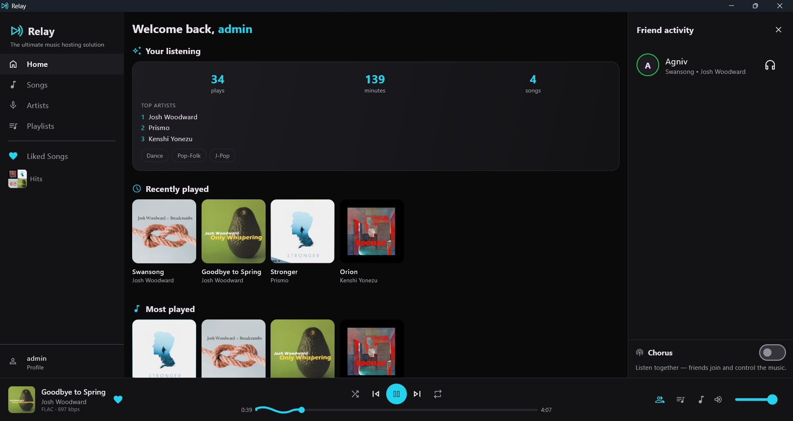
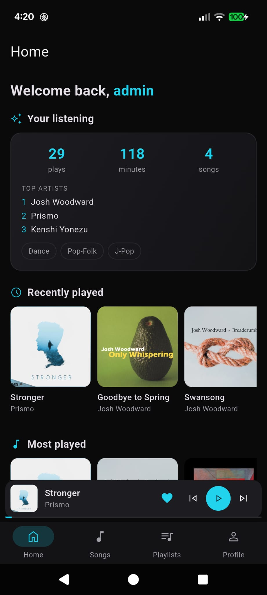
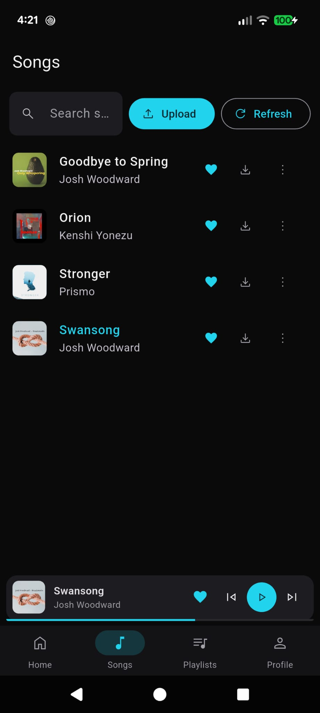
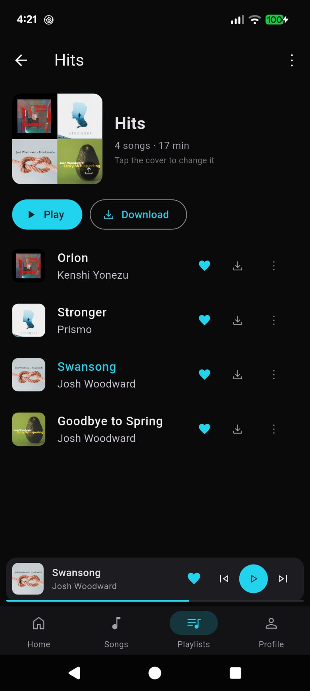
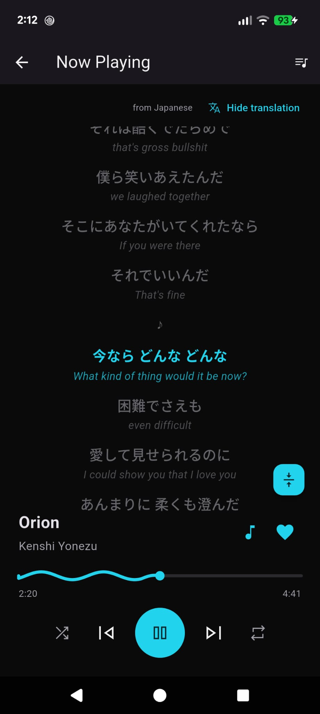

# Relay — self-hosted music streaming

Your own music server: host audio files on a box you control, manage everything
from a web instance, and stream to a browser, a Windows desktop app, and Android —
with collaborative listening, friend activity, lyrics, and offline downloads.



<p align="center">
  
  
  
  
</p>

## Get the apps

| Platform | Where |
|---|---|
| **Android** | [Google Play](https://play.google.com/store/apps/details?id=site.agniv.relay) |
| **Windows** | The `Relay-Windows-<version>.zip` attached to the latest [GitHub Release](../../releases/latest). Extract it anywhere and run `Relay.exe`. |
| **Browser** | Your own server's web address (the web app is part of the server stack). |

On first launch, enter your server's URL and sign in. New users join with an invite
code from the server admin ("Have an invite code? Create an account").
Relay needs a server: see [Quick start](#quick-start-docker--recommended) to run your own.

## Repository layout

```
relay/
├── server/      Express + TypeScript + Prisma API (auth, library scan, streaming, transcoding, social, chorus)
├── web/         Next.js web app — admin + browser player (also the /api reverse proxy)
├── app/         Flutter app — Windows / Android, one codebase
├── tools/       Local Flutter SDK / JDK / Android SDK (auto-downloaded; git-ignored)
├── music/       Your audio library (git-ignored; bind-mounted into the server)
├── data/        Derived data e.g. extracted cover art (git-ignored)
├── docker-compose.yml
└── .env         Secrets + config (copy from .env.example; git-ignored)
```

## Features

**Library & playback**
- Recursive library scan (tags via `music-metadata`, embedded cover art, incremental rescans).
- Gapless-ish queue, repeat (off/all/one), shuffle, seek with a squiggly progress bar.
- Direct streaming with HTTP **Range** (seeking) + on-the-fly ffmpeg transcoding (`?format=…&bitrate=…`).
- Lyrics with **line-by-line translations** (fetched + stored at upload, shown synced, saved with downloads for offline).
- In-app uploads (MP3/FLAC, content-sniffed) including chunked uploads for files over the CDN body cap.
  Every new file is decoded once at ingest; truncated/corrupt files with no playable audio are rejected,
  and exact duplicates are caught by content hash (SHA-256) on every ingest path.
- Optional **auto-tagging** (set `ACOUSTID_API_KEY`): AcoustID fingerprint lookup + MusicBrainz metadata
  fill in missing or placeholder tags (never overwrites real ones, never modifies files).

**Social**
- **Friend activity** panel — who's online and what they're playing (or last played).
- **Listen Along** — play a friend's music on your own device, kept in sync.
- **Privacy** — each user can stop sharing their activity / history / likes, and separately
  disallow listen-along (Profile → Privacy & sharing). Private playlists are visible only to
  the owner and collaborators.
- **Chorus** — collaborative listening (like Spotify Jam, but join from anywhere). Audio plays
  **only on the host's device**; members are silent remote controls that can change the song,
  edit the queue, play/pause, and seek. Auto-starts when you play; open or ask-to-join.
- User profiles, likes / Liked Songs, playlists with collaborators.

**Listening**
- **Autoplay** keeps the music going with similar songs when the queue runs out.
- **Volume normalization** (EBU R128, measured at ingest; attenuation only) and **crossfade**
  (0 to 12 s, a true overlap on every client).
- **Chromecast** from the Android, Windows and web apps (Default Media Receiver; no extra setup).
- **Scrobbling** to Last.fm and ListenBrainz, per user.
- **Playlist import** from M3U files, pasted lists or Spotify links; drag-to-reorder and
  multi-select in playlists.
- **Rewind**: a yearly listening recap with a shareable card.

**Apps**
- Windows + Android from one Flutter codebase; background playback, lock-screen / media-key
  controls (Windows SMTC included), Android Auto browsing and voice search, a desktop mini player.
- **Offline mode** — downloaded songs/playlists play with no connection, even logged out.
  Wi-Fi-only downloads and storage management on Android.

**Admin**
- Web admin dashboard: users, roles, invite codes (uses + expiry), storage, rejected uploads.

**Real-time sync** uses long-polling (the server holds the request and returns the instant
state changes) so pauses/seeks/song-changes propagate in well under a second, with exponential
backoff on errors. Clients estimate their offset from the server clock NTP-style (fastest of a few
pings to `/api/social/time`), stamp each reported position with the server time it was true at
(`atServerMs`, so upload latency and out-of-order posts don't skew it), and extrapolate the host's
position to "now" on arrival (covering download latency and track load time).

**Outside services.** Relay's developer runs no servers, but your server does contact a few
services about the *music* (never about users): LRCLIB and Musixmatch for lyrics (artist, title,
album, length), Google Translate for lyric translations (the lyric text), and, only if
`ACOUSTID_API_KEY` is set, AcoustID/MusicBrainz for auto-tagging (an audio fingerprint + length).
Scrobbling (Last.fm / ListenBrainz) and Spotify playlist import only run for users who turn them on.
The Musixmatch and Google Translate endpoints are unofficial and can stop working at any time;
lyrics then fall back to LRCLIB, and translations are skipped.

## Quick start (Docker — recommended)

Everything runs in containers; the only thing you install is Docker.

```bash
cp .env.example .env        # then edit: set MUSIC_DIR, set strong secrets (see below)
docker compose up -d --build
```

- The web app listens on `127.0.0.1:3000` (loopback only — see Deployment).
- The first admin is created automatically from `ADMIN_USERNAME` / `ADMIN_PASSWORD`.
- Point `MUSIC_DIR` at the folder holding your audio. In-app uploads also land there.
- Log in and trigger a library scan from the admin page.

## Production deployment

This instance runs behind a **Cloudflare Tunnel** (`cloudflared` on the host) → the **web
container** → the **API container** over the internal Docker network.

```
Browser / apps ──HTTPS──> Cloudflare ──tunnel──> cloudflared (host)
                                                     │ localhost
                                              web container (Next.js)
                                                     │  /api/* rewrite (internal network)
                                              server container (Express)  ──>  postgres
```

**The tunnel is the only ingress.** All container ports are bound to **loopback** (or not
published at all), so nothing is reachable on the host's public IP:

- `postgres` → `127.0.0.1:5432` (internal network only)
- `server`   → **no published port** (reached only via the web container's `/api` proxy)
- `web`      → `127.0.0.1:3000` (the host `cloudflared` connects here)

> Do not publish any of these to `0.0.0.0` — that would bypass Cloudflare's WAF/rate limiting.
> Binding to loopback protects you even if the host firewall is off. A
> `docker-compose.override.yml` (git-ignored) may remap the web port on a specific host;
> keep it loopback-bound there too.

The web container holds `NEXT_PUBLIC_API_URL` (your public origin) and proxies `/api/*` to the
API over the Docker network, so the browser only ever talks to your own origin (no CORS, no
mixed content). `prisma migrate deploy` runs automatically on server start.

## Security posture

- **Headers** — `helmet` on the API; CSP + `X-Frame-Options`/`frame-ancestors`,
  `X-Content-Type-Options`, `Referrer-Policy`, `Permissions-Policy`, and HSTS on the web app.
- **CORS** — default-deny; only origins in `CORS_ORIGINS` may call the API cross-origin (the web
  app uses a same-origin proxy and native apps send no `Origin`, so this is usually just your domain).
- **Rate limiting** — `express-rate-limit` on login/refresh (brute-force defense, on top of
  Cloudflare); a per-user cap on concurrently-held long-poll connections (DoS defense).
- **Auth** — JWT access + refresh, `bcrypt` (cost 12). The server refuses to seed a weak/default
  `ADMIN_PASSWORD` in production. Chorus enforces host-only state writes server-side.
- **Robustness** — rejected async handlers return 500 instead of hanging; orphaned ffmpeg
  transcodes are killed on client disconnect.

**Recommended further hardening** (not enabled by default to avoid volume-permission churn):
run the `server`/`web` containers as a non-root user, and enable a host firewall (`ufw`) as
defense-in-depth.

## Configuration (`.env`)

| Var | What |
|-----|------|
| `POSTGRES_USER` / `POSTGRES_PASSWORD` / `POSTGRES_DB` | Database. Use a long random password. |
| `DATABASE_URL` | Server's DB connection (Docker host is `postgres`; local is `localhost`). |
| `JWT_SECRET` | Long random secret (>= 32 chars; placeholders refused in prod). `node -e "console.log(require('crypto').randomBytes(48).toString('hex'))"` |
| `MUSIC_DIR` | Host folder with your audio (bind-mounted to `/music`, writable for uploads). |
| `ADMIN_USERNAME` / `ADMIN_PASSWORD` | First admin (created on empty DB). Strong password required in prod. |
| `CORS_ORIGINS` | Comma-separated browser origins allowed cross-origin (e.g. your domain). |
| `NEXT_PUBLIC_API_URL` | Public origin the apps/browser use (your domain in prod). |

## API cheat sheet

```
POST /api/auth/login            { username, password } -> { accessToken, refreshToken, user }
POST /api/auth/refresh          { refreshToken } -> { accessToken, refreshToken }  (rotating: store the new refreshToken; reusing an old one revokes the session)
POST /api/auth/media-token      -> { token, expiresAt }  7-day token for ?token= on stream/cover URLs only
GET  /api/auth/invite/:code     -> { valid, role? }  (doesn't use the code)
POST /api/auth/register         { code, username, password } -> { accessToken, refreshToken, user }
POST /api/auth/change-password  { currentPassword, newPassword } -> { ok, accessToken, refreshToken, user }  (revokes other sessions)
POST /api/auth/logout-all       sign out of all devices (revokes every token) -> 204
GET  /api/auth/me

GET  /api/library/artists | /albums | /albums?recent=1
GET  /api/library/tracks?q=&limit=&offset=
GET  /api/library/tracks/by-ids?ids=a,b,c
PATCH /api/library/tracks/:id                    { title?, artist?, album?, year?, genre?, trackNo?, discNo? }  edit metadata, DB only (ADMIN or uploader)
GET  /api/library/tracks/:id/lyrics
POST /api/library/upload                         multipart  (chunked: /upload/chunk + /upload/finalize)
POST /api/library/scrobble                       { trackId, playlistId? }  play started (records history, "now playing")
POST /api/library/scrobble/complete              { trackId, startedAt }  finished listen -> ListenBrainz / Last.fm
GET  /api/library/recently-played | /most-played
GET  /api/library/radio?seed=&exclude=a,b&limit=20  autoplay / radio -> Track[]
POST /api/library/tracks/bulk-delete             { ids } -> { deleted, forbidden }
GET  /api/library/stats/me                       all-time listening summary
GET  /api/library/stats/wrapped?year=YYYY        year-end "Rewind" summary
GET  /api/search?q=                              -> { tracks, albums, artists, playlists }

GET  /api/stream/:trackId                         direct, Range-aware
GET  /api/stream/:trackId?format=mp3&bitrate=128  transcoded
GET  /api/stream/:trackId?format=mp3&bitrate=320&start=42.5  transcoded from 42.5s (how clients seek a transcode)
GET  /api/stream/:trackId/cover                   album art
GET  /api/stream/album/:albumId/cover             album art
     (stream + cover routes, incl. /api/playlists/:id/cover, take ?token=<media token> so <audio>/
      can auth; every other route needs the Authorization: Bearer header)

GET/POST/PATCH/DELETE /api/playlists ...          (+ /collaborators, /tracks, /tracks/bulk, /cover)
PATCH /api/playlists/:id/tracks/order             { trackIds }  full new order -> 204
POST  /api/playlists/:id/tracks/remove            { trackIds } -> { removed }
POST  /api/playlists/import                       { name, source: m3u|text|spotify, content?, url? }
                                                  -> { playlistId, matched, total, unmatched }
POST/DELETE           /api/library/like ...        likes / Liked Songs

GET  /api/social/friends
GET  /api/social/users/:id
GET  /api/social/activity/:userId  | /activity/:userId/poll?since=   listen-along (long-poll)
POST /api/social/activity                          presence heartbeat (optional atServerMs)
GET  /api/social/time                              server clock (listen-along sync)
GET  /api/social/privacy | PATCH                   shareActivity / allowListenAlong

GET  /api/chorus | /chorus/poll?since=             collaborative session (long-poll)
POST /api/chorus/{start,stop,leave,mode,join,approve,deny,remove,state,command}

GET  /api/scrobbling                              -> { listenbrainz: {connected, username}, lastfm: {connected, username, available} }
POST/DELETE /api/scrobbling/listenbrainz          { token }
POST /api/scrobbling/lastfm/start                 -> { authUrl, token }  then approve in a browser
POST /api/scrobbling/lastfm/complete              { token }
DELETE /api/scrobbling/lastfm

GET/POST        /api/admin/users | /admin/scan    (ADMIN)
GET             /api/admin/stats                   (ADMIN)
GET             /api/admin/dashboard               storage, counts, users, ingest rejections (ADMIN)
GET/POST        /api/admin/invites                 { role?, maxUses?, expiresInDays?, note? } (ADMIN)
DELETE          /api/admin/invites/:id             revoke (ADMIN)
```

## Building the apps

The Flutter app builds for Windows and Android from `app/`:

```bash
cd app
flutter build appbundle --release    # Android (signed AAB for Google Play)
flutter build apk --release          # Android APK for sideloading / testing
flutter build windows --release      # Windows (needs the VS C++ toolchain)
```

Built apps are never committed. Android releases go through Google Play; Windows builds are
attached to [GitHub Releases](../../releases) (zip `app/build/windows/x64/runner/Release` and
include [THIRD_PARTY_NOTICES.md](THIRD_PARTY_NOTICES.md)). Note that Google Play re-signs the app,
so an APK you build yourself can't update a Play install (uninstall first).

**Android signing** — release builds are signed from `app/android/key.properties` (git-ignored),
which points at a keystore (also git-ignored). If those are absent the build falls back to debug
signing so a fresh clone still compiles. To create your own:

```bash
keytool -genkeypair -v -keystore app/android/app/relay-release.jks -keyalg RSA -keysize 2048 \
  -validity 10000 -alias relay
# then write app/android/key.properties:
#   storePassword=…  keyPassword=…  keyAlias=relay  storeFile=relay-release.jks
```

Keep the keystore + its password safe — you need the same key to ship updates.

## Android Auto

Relay is a full media browser app in the car. Once your phone is connected, Relay
appears in the car's app list and behaves like any built-in media app.

- **Browse** four tabs (Home, Playlists, Songs and Recents). Home leads with Liked
  Songs and Most Played, then your playlists with cover art. Tapping an item plays
  it with its whole context queued.
- **Resume card** on connect: the media card shows your last played song with its
  saved position, paused and ready. Press play to pick up from there. The last
  session is restored from local storage so the card appears instantly and offline,
  without opening the app on the phone first.
- **Voice**: "play <song>" resolves through the media session and plays the best
  ranked match. "Hey Google, play <song> on Relay" cold-launches the app via the
  `MEDIA_PLAY_FROM_SEARCH` intent, which `MainActivity` forwards to the same
  `onPlayFromSearch` path. An empty query resumes your recent music.
- **Search** from the car queries your library ranked by relevance (word-start
  matches beat mid-word substrings).

**Implementation notes.** Browse, search and play-from-car are answered at the
`SwitchAudioHandler` level in the patched `just_audio_background` fork, so they work
before any just_audio player exists (a cold car connection, where the per-player
handler has not been created yet). Cold-start browse requests that reach the native
`MediaBrowserService` before the Flutter engine attaches are held (`result.detach()`)
and replayed once the handler is ready, instead of being answered empty, which
Android Auto would otherwise cache as a permanent "No items". These live in the
patched forks under `app/third_party/audio_service` and
`app/third_party/just_audio_background`.

**Testing without a car.** Use the Desktop Head Unit (DHU) from the Android SDK. In
the Android Auto app on the phone enable developer mode, then "Start head unit
server". Forward the port and launch the DHU:

```bash
adb forward tcp:5277 tcp:5277
"$ANDROID_SDK_ROOT/extras/google/auto/desktop-head-unit"
```

Watch the app's media-browser activity with `adb logcat -s RelayAA`. You can drive a
voice "play" without speaking by firing the intent directly:

```bash
adb shell am start -a android.media.action.MEDIA_PLAY_FROM_SEARCH \
  -n site.agniv.relay/.MainActivity --es query "your song"
```

## Local development

Run Postgres in Docker and the server on the host for hot-reload:

```bash
docker compose up -d postgres
cd server && npm install && npm run prisma:generate
npm run prisma:migrate     # first time
npm run dev                # tsx watch
```

The web app: `cd web && npm install && npm run dev` (set `NEXT_PUBLIC_API_URL=http://localhost:4000`).

## Tests

Unit tests need no database, ffmpeg, Docker or network.

```bash
cd server && npm run build && npm test   # node:test via tsx (build first: it generates the Prisma client)
cd web && npm test                       # node:test with Node's built-in TypeScript stripping
cd app && flutter test                   # Flutter unit tests (use the SDK in tools/flutter)
```

- **Server** (`server/test/*.test.ts`): JWT sign/verify and token-type separation, the auth
  middleware (which token types each route family accepts, revocation), refresh-token rotation
  and reuse detection (against an in-memory fake of the Prisma calls), Range parsing, loudness
  parsing, playlist import parsing/matching, invite codes, search ranking, rate-limit keys,
  query coercion, env boot checks, and the in-memory Chorus/poll-guard invariants.
- **Web** (`web/test/*.test.ts`): track sorting, the Rewind schedule, playback/recent-search
  prefs, the loudness normalization factor and format helpers. `test/register.mjs` resolves the
  `@/` alias without extra dependencies.
- **App** (`app/test/*_test.dart`): the same sort, Rewind-schedule and loudness tables as the web
  tests (so the clients stay in step), settings/recent searches, cover cache keys, server URL
  normalization and model JSON.

**Smoke test against a live deployment** (not part of `npm test`; it creates a throwaway
playlist and, for admins, an invite, and removes both even on failure):

```bash
cd server
BASE_URL=https://relay.example.com RELAY_USERNAME=alice RELAY_PASSWORD='…' node test/smoke/smoke.mjs
# add SMOKE_REFRESH_REUSE=1 to also check refresh-token reuse detection
# (waits 31 s and revokes the refresh-token family of the smoke test's own login)
```

It prints a PASS/FAIL table and exits non-zero on any failure. On Windows use `RELAY_USERNAME`,
because `USERNAME` is always set to the OS login name.

**CI** (`.github/workflows/ci.yml`) runs on pushes and pull requests to `main`: the server
builds and runs its unit tests, the web app type-checks, tests and builds, and the Flutter app
runs `flutter analyze` (lib + test) and `flutter test`. It needs no secrets and builds no
release APKs.

## Status

- [x] **Server** — auth, scan, stream (Range), transcode, playlists, likes, social, chorus, admin. Hardened + verified end-to-end.
- [x] **Web** — login, admin, browser player, friends, listen-along, chorus, lyrics. Security headers + CSP.
- [x] **Flutter app** — Windows + Android: browse/search/player, background playback, Android Auto, friends, listen-along, chorus, offline downloads. Release-signed APK.

## License

Relay is licensed under the [GNU Affero General Public License v3.0](LICENSE) (AGPL-3.0-only).
You can use, modify and self-host it freely. If you distribute a modified version, or run one
as a service for other people, you must publish your changes under the same license.
The forks in `app/third_party/` keep their own licenses (MIT / Unlicense); see
[THIRD_PARTY_NOTICES.md](THIRD_PARTY_NOTICES.md).

## Security

Please report vulnerabilities privately; see [SECURITY.md](SECURITY.md).

## Third-party software

Relay builds on open-source components and talks to a few outside services; see
[THIRD_PARTY_NOTICES.md](THIRD_PARTY_NOTICES.md).
